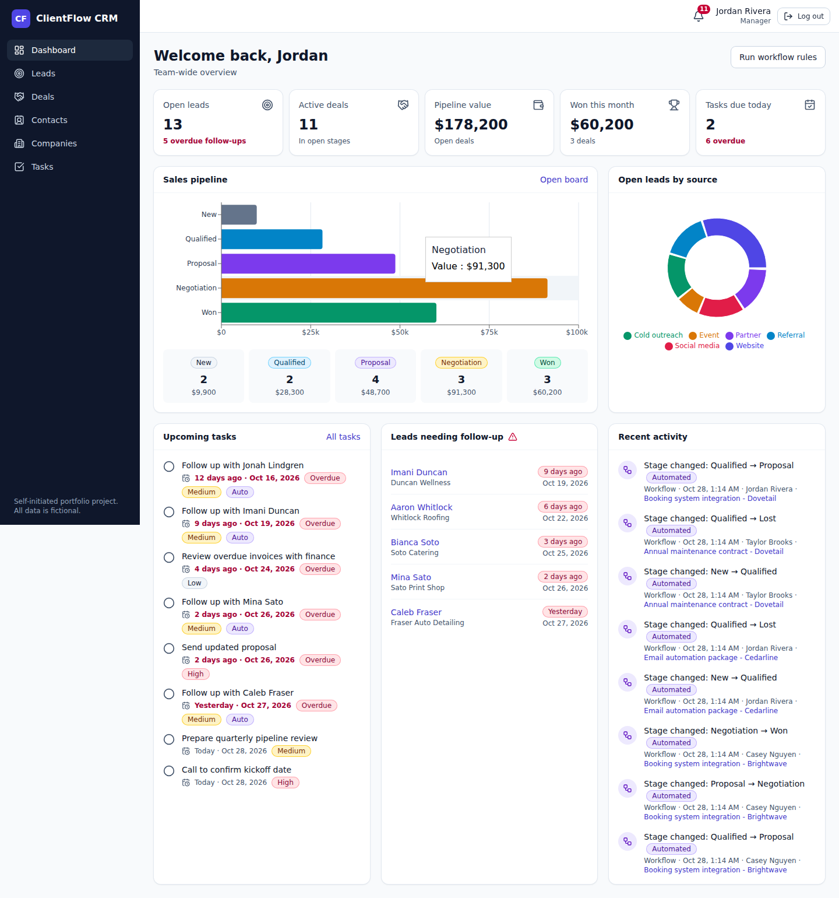
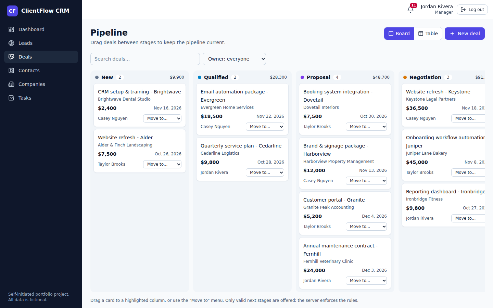
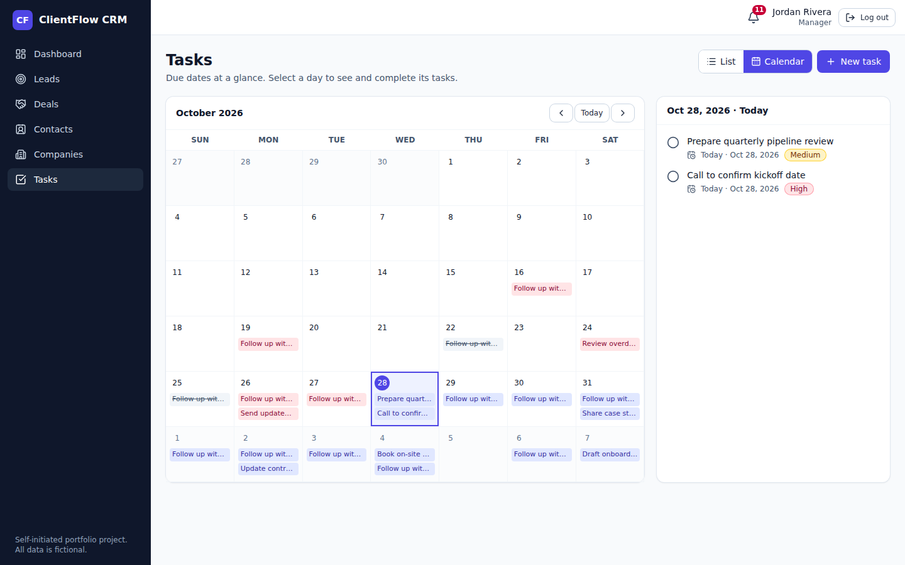
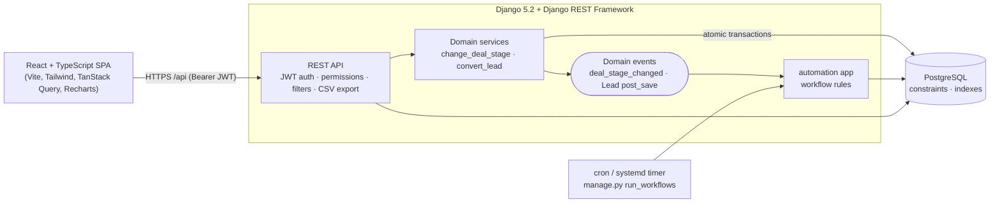
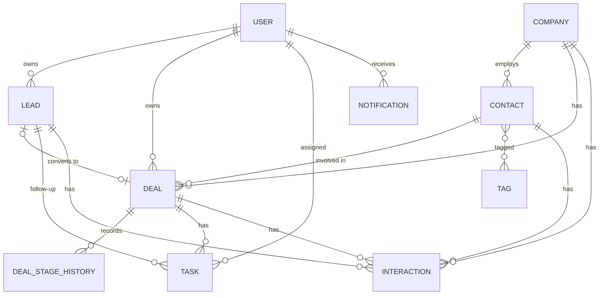

# ClientFlow CRM

A compact, full-stack CRM for small service businesses: contacts and companies, a lead-to-deal sales pipeline, tasks and reminders, an activity history, and built-in follow-up automation.

## 🚀 Live Demo

**Try ClientFlow CRM online:** [rayenbenmahmoud-clientflow.duckdns.org](https://rayenbenmahmoud-clientflow.duckdns.org)

Explore the CRM dashboard, manage leads and contacts, move deals through the sales pipeline, and test task management and workflow automation.

> **Demo environment:** All records and user accounts are fictional. This is a portfolio demonstration, not a production CRM.

> **Self-initiated portfolio project.** ClientFlow CRM was built to demonstrate business-systems development, CRM customisation, API design and workflow automation. It is **not** a client project, has **no real users**, and has **not been deployed to production**. All companies, people, e-mail addresses and phone numbers in the demo data are fictional.



| Pipeline board | Task calendar |
|---|---|
|  |  |

More screenshots are in [`docs/screenshots/`](docs/screenshots) (leads, deal detail, contacts, notifications, mobile).

## Features

- **Secure login & roles** - JWT auth (refresh rotation + logout blacklist), rate-limited login, three roles: *admin*, *manager*, *sales rep*.
- **Dashboard** - open leads, overdue follow-ups, active deals, pipeline value, won this month, tasks due; pipeline chart, leads-by-source chart, upcoming tasks, recent activity.
- **Contacts & companies** - business details, notes, colour tags, linked records, full activity history per record.
- **Leads** - source, status, owner, follow-up date, estimated value, overdue flag, and one-click **conversion** into company + contact + deal (atomic).
- **Sales pipeline** - New → Qualified → Proposal → Negotiation → Won / Lost. Kanban board with drag-and-drop *and* an accessible "Move to" menu; table view; stage history per deal.
- **Tasks** - list and month-calendar views, priorities, complete/reopen, links to leads/deals/contacts.
- **Interaction history** - log calls, meetings, emails and notes against contacts, companies, leads and deals.
- **Search, filter, sort, paginate, export** - on every list; CSV export honours the current filters and the user's permissions.
- **Workflow automation** - see [Workflow rules](#workflow-rules).
- **In-app notifications** - bell with unread count.
- **Responsive & accessible UI** - sidebar that collapses to a drawer, keyboard-friendly dialogs, labelled controls, contrast-checked badges, reduced-motion support.
- **OpenAPI/Swagger** docs generated from the code.

## Architecture



**Backend apps** (`backend/apps/`)

| App | Responsibility |
|---|---|
| `accounts` | Custom user with roles, JWT login/refresh/logout, user admin API |
| `core` | Shared kernel: permissions, pagination, CSV export (formula-injection safe), error handling, demo seed command |
| `crm` | Companies, contacts, tags |
| `sales` | Leads, deals, stage-transition rules, stage history, conversion services |
| `activities` | Interactions, tasks, notifications |
| `automation` | Workflow rules, signal receivers, `run_workflows` command |
| `dashboard` | Aggregated dashboard endpoint |

**Why it is built this way**

- *Stage changes are an action, not a field.* `PATCH /deals/{id}/` ignores `stage`; `POST /deals/{id}/change-stage/` runs `services.change_deal_stage`, which locks the row, checks the transition table, writes history and emits an event, all in one transaction.
- *Workflow rules react to events.* The sales code never calls the automation code; it emits `deal_stage_changed` and the automation app subscribes. If a rule fails, the whole change rolls back.
- *Rules live on the server and in the database.* Permissions, validation and `CHECK`/`UNIQUE` constraints are enforced server-side; the UI mirrors them only as hints.

<details>
<summary>Data model</summary>



</details>

## Roles & permissions

| Capability | Sales rep | Manager | Admin |
|---|:--:|:--:|:--:|
| See own leads / deals / tasks | ✅ | ✅ | ✅ |
| See other people's leads / deals / tasks | ❌ (404) | ✅ | ✅ |
| Create records and assign owner | self only | anyone | anyone |
| Companies, contacts, tags: read / create / edit | ✅ | ✅ | ✅ |
| Delete companies, contacts, tags, deals | ❌ | ✅ | ✅ |
| Delete own leads and tasks | ✅ | ✅ | ✅ |
| Edit / delete interactions | own only | ✅ | ✅ |
| Run workflow rules on demand | ❌ | ✅ | ✅ |
| Create / edit / deactivate users | ❌ | ❌ | ✅ |

Automatically generated (workflow) timeline entries are read-only for everyone.

## Workflow rules

| # | Trigger | Action |
|---|---|---|
| 1 | A lead is created (API, admin, shell, seed...) | Create a follow-up task for the lead's owner, due on the follow-up date (default: +2 days, which is also written to the lead). |
| 2 | Open lead's follow-up date has passed | Computed live as `is_overdue` in every API response and filter. `manage.py run_workflows` (or **Run workflow rules** on the dashboard) also persists a flag and notifies the owner **once**; it un-flags leads that are no longer overdue. |
| 3 | A deal changes stage | Notify the deal owner and add a read-only "Stage changed" entry to the deal timeline. |

Rule 2 is time-based, so schedule it, for example daily at 07:00:

```cron
0 7 * * *  cd /path/to/clientflow-crm/backend && .venv/bin/python manage.py run_workflows
```

### Pipeline transitions (enforced by the API)

```
New ⇄ Qualified ⇄ Proposal ⇄ Negotiation → Won (final)
 any open stage → Lost (reason required) → New (reopen)
```

## Quick start

### Option A - Docker Compose *(written but not verified, see [Verification status](#verification-status))*

```bash
cp .env.example .env        # set DJANGO_SECRET_KEY and POSTGRES_PASSWORD
docker compose up --build
# open http://localhost:8080  (API docs: http://localhost:8080/api/docs/)
```

Demo data is seeded on first start (`SEED_DEMO=true`); set it to `false` for an empty system.

### Option B - Local development (verified)

Requirements: Python 3.12+, Node 20+ (developed on 22), PostgreSQL 14+.

```bash
# 1. PostgreSQL role + database (adjust the password; keep it in sync with .env)
sudo -u postgres psql -c "CREATE USER clientflow WITH PASSWORD 'change-me-db-password' CREATEDB;"
sudo -u postgres psql -c "CREATE DATABASE clientflow OWNER clientflow;"

# 2. Configuration
cp .env.example .env
#   edit .env: set DJANGO_SECRET_KEY and POSTGRES_PASSWORD (must match step 1)

# 3. Backend  (http://127.0.0.1:8000)
cd backend
python3 -m venv .venv && source .venv/bin/activate      # Windows: .venv\Scripts\activate
pip install -r requirements-dev.txt
python manage.py migrate
python manage.py seed_demo          # prints the demo logins
python manage.py runserver

# 4. Frontend, in a second terminal  (http://localhost:5173)
cd frontend
npm install
npm run dev
```

Open <http://localhost:5173>. The Vite dev server proxies `/api` to Django, so no CORS setup is needed.

### Demo accounts

All accounts are fictional and created by `seed_demo` with the password in `DEMO_PASSWORD` (default `ClientFlow-Demo-2026`, **change it for anything shared**).

| Username | Role | What to look at |
|---|---|---|
| `manager` | Manager | Team-wide dashboard, all pipelines, reassigning owners |
| `rep` | Sales rep | Personal view; cannot see `rep2`'s records or delete companies |
| `rep2` | Sales rep | Second rep, for testing isolation |
| `admin` | Admin | Everything, plus user management via API / `/admin/` |

Reset the demo at any time: `python manage.py seed_demo --reset` (refuses to run with `DJANGO_DEBUG=false` unless you add `--yes-i-am-sure`).

## API

Interactive docs: **<http://127.0.0.1:8000/api/docs/>** (Swagger UI) · `/api/redoc/` · raw schema `/api/schema/`.
Endpoint reference, filters and error format: [`docs/API.md`](docs/API.md).

```bash
TOKEN=$(curl -s -X POST localhost:8000/api/auth/login/ -H 'Content-Type: application/json' \
  -d '{"username":"manager","password":"ClientFlow-Demo-2026"}' | python3 -c "import sys,json;print(json.load(sys.stdin)['access'])")
curl -s "localhost:8000/api/deals/?stage=negotiation&ordering=-amount" -H "Authorization: Bearer $TOKEN"
```

## Tests & quality checks

```bash
# Backend: 120 tests against real PostgreSQL (creates/drops a `test_clientflow` database)
cd backend && source .venv/bin/activate
python -m pytest
ruff check . && ruff format --check .

# Frontend
cd frontend
npm run typecheck && npm run lint && npm run build

# Browser end-to-end (Playwright) - needs backend + frontend running and seeded demo data
pip install playwright && playwright install chromium
python scripts/e2e_browser.py          # 22 checks; MUTATES demo data, re-seed afterwards
python scripts/capture_screenshots.py  # regenerates docs/screenshots from a fresh seed
```

What the backend tests cover: login/refresh/logout/throttling; role scoping and ownership rules; **every** pipeline transition (allowed *and* forbidden, with a completeness check against the transition table); lost-reason and closed-date rules; database constraints; rollback when a workflow rule fails; lead conversion (including rollback); follow-up task creation; overdue flagging; validation messages; search/filter/sort/pagination; CSV export (scoping, formula-injection and phone-number handling); dashboard numbers; seed command; OpenAPI schema.

## Project structure

```
backend/   Django project (config/), apps/, tests/, Dockerfile
frontend/  React + TypeScript SPA (src/api, components, pages), Dockerfile, nginx.conf
docs/      API reference, screenshots
portfolio/ Upwork portfolio write-ups (project summary, case study, demo script...)
scripts/   Playwright end-to-end test and screenshot generator
```

## Security notes

- Secrets only via environment variables; `.env` is git-ignored; the app **refuses to start** with `DJANGO_DEBUG=false` and no `DJANGO_SECRET_KEY`.
- Permissions and validation are server-side; rep access is enforced in the queryset (other people's records return 404, not 403).
- JWT access tokens are short-lived (30 min); refresh tokens rotate and are blacklisted on logout; login is rate-limited (default 10/min).
- CSV exports prefix cells starting with `= + - @` to neutralise spreadsheet formula injection (phone numbers like `+1 555-0100` are kept intact).
- Passwords validated with Django's validators (min. length 10, common/numeric checks).
- In production mode: HTTPS redirect, HSTS, secure cookies, `X-Content-Type-Options`.
- **Known trade-off:** the SPA keeps JWTs in `localStorage` for simplicity. For a production system, move to `httpOnly` `SameSite` cookies (plus CSRF protection) to remove token exposure to XSS.

## Deployment notes

These are guidelines; **this project has not been deployed to production.**

1. Set `DJANGO_DEBUG=false`, a strong `DJANGO_SECRET_KEY`, `DJANGO_ALLOWED_HOSTS`, and `CSRF_TRUSTED_ORIGINS` (with `https://` origins).
2. Run PostgreSQL as a managed service or with backups; use a dedicated DB role without superuser rights.
3. Build the SPA (`npm run build`) and serve `frontend/dist` from the same domain as the API (see `frontend/nginx.conf`), or set `VITE_API_BASE` and `CORS_ALLOWED_ORIGINS` for a split-domain setup.
4. Run `gunicorn config.wsgi:application`; static files are served by WhiteNoise after `collectstatic`.
5. Terminate TLS at a reverse proxy and forward `X-Forwarded-Proto: https` (the app then redirects HTTP→HTTPS and sends HSTS). `check --deploy` also suggests `SECURE_HSTS_INCLUDE_SUBDOMAINS`/`PRELOAD`; those are left off deliberately because they affect all subdomains.
6. Schedule `manage.py run_workflows` (cron/systemd timer).
7. Do **not** run `seed_demo` on a real database.

## Troubleshooting

| Symptom | Fix |
|---|---|
| `ImproperlyConfigured: DJANGO_SECRET_KEY is not set` | Create `.env` from `.env.example` (repo root) or set `DJANGO_DEBUG=true` for local development. |
| `connection refused` / `password authentication failed` | Start PostgreSQL; make `POSTGRES_*` in `.env` match the role you created. |
| `permission denied to create database` when testing | The DB role needs `CREATEDB` (`ALTER USER clientflow CREATEDB;`). |
| Frontend loads but every request fails | Backend not running on :8000, or set `VITE_PROXY_TARGET`. |
| Login says "Too many attempts" | The login throttle (10/min) triggered; wait a minute or raise `LOGIN_THROTTLE_RATE`. |
| `seed_demo`: "Demo users already exist" | Use `seed_demo --reset`. |
| `npm install` peer-dependency error on TypeScript | `typescript-eslint` doesn't support TypeScript 7 yet; this repo pins TypeScript `~6.0`. |
| Docker: `Set DJANGO_SECRET_KEY in .env` | Copy `.env.example` to `.env` and fill both required values. |

## Verification status

Checked in the build environment (Ubuntu 24.04, Python 3.12, Node 22, PostgreSQL 16):

- ✅ 120 backend tests pass; `ruff check` and `ruff format --check` clean; migrations in sync with models; OpenAPI schema validates with zero warnings.
- ✅ Frontend: `tsc --noEmit`, ESLint and `vite build` pass.
- ✅ 22 browser checks pass in Chromium (login, role scoping, lead → task automation, lead conversion, stage moves incl. drag-and-drop, validation, CSV download, mobile layout).
- ✅ Production mode: gunicorn + WhiteNoise, HTTPS redirect, HSTS, refusal to boot without a secret.
- ✅ The setup steps in *Option B* were executed from a clean copy of the repository.
- ⚠️ **Not verified:** `docker compose` (Docker was unavailable in the build environment; the files are syntax-checked only).
- ⚠️ **Not verified:** Windows/macOS, Firefox/Safari, touch-device drag-and-drop (the "Move to" menu is the touch-friendly path), screen-reader testing, and any load/performance testing.

## Known limitations / ideas

- Select inputs load the first 100 companies/contacts/users; very large datasets would need async search pickers.
- Deleting a contact also deletes interactions logged against it (documented cascade); companies with deals cannot be deleted (returns 409).
- No e-mail delivery, file attachments, import, or custom fields yet. Natural next steps: scheduled workflow worker (Celery/cron), e-mail notifications, CSV import, audit log, webhooks.
- The frontend has no unit tests (behaviour is covered by the browser script).

## License

Released under the **MIT License** - see [`LICENSE`](LICENSE). Third-party components and their licenses are summarised in [`THIRD_PARTY_NOTICES.md`](THIRD_PARTY_NOTICES.md). To report a security issue, see [`SECURITY.md`](SECURITY.md).
